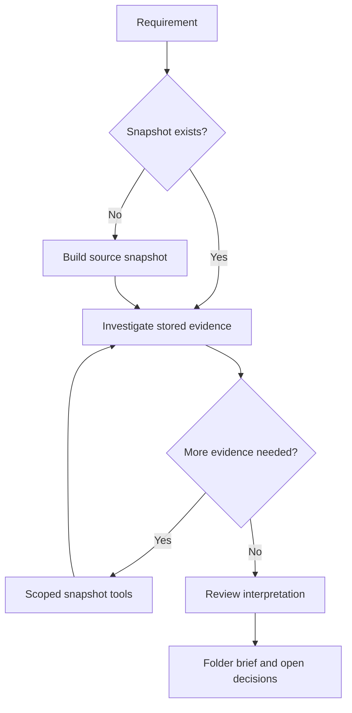

# Architecture and design decisions

ReqContext converts an incomplete implementation request into candidate scope,
applicable constraints and unresolved decisions using a model and stored evidence.
It does not implement the requested change or prove the interpretation correct.

## Components

| Module | Responsibility |
|---|---|
| `index.py` | File selection, content fingerprints, SQLite FTS, folder/symbol/call-name indexes and snapshot publication |
| `c_parser.py` | Optional syntactic C function/call observations using Tree-sitter |
| `documents.py` | Explicit reference selections, bounded PDF/text extraction and page provenance |
| `core.py` | Brief representation, source-bound clarification memory and orchestration |
| `investigation.py` | Bounded model-selected tools, output-schema checks and review pass |
| `models.py` | User-configured JSON chat endpoint transport |
| `mcp_server.py` | Host-model access to snapshot tools and optional nested analysis |
| `cli.py` | Build/refresh and analysis commands |

## Principles

- Investigate before proposing behavior; inspect existing implementation.
- Preserve source identity, page/revision metadata and uncertainty.
- Code is an observation of existing behavior, not automatically a requirement.
- Semantic selection belongs to the model; mechanical validation belongs to Python.
- Clarifications should explain consequential alternatives, not follow keyword rules.
- Keep source refresh separate from requirement analysis.

## Snapshot consistency

A refresh hashes eligible sources, reuses unchanged parsing/index entries, updates
references, rebuilds folder/call-name metadata, then publishes a new snapshot ID,
capture time and HEAD. All those SQLite changes are in one transaction. Unexpected
refresh failure rolls back to the last committed snapshot. Individual reference
extraction failures are handled as documented skipped references: stale entries are
removed, a warning is recorded and the remaining snapshot can commit.

This is database publication atomicity, not an atomic filesystem capture. Live files
can change during capture; HEAD may not match uncommitted source content. Evidence
hashes identify the bytes actually indexed. A snapshot ID identifies a capture; it
is not a cryptographic signature or freshness guarantee.

Readers use frozen evidence until an explicit refresh. Ordinary queries do not
hash live sources, so they cannot automatically detect staleness. Clarification
staleness is relative to the stored snapshot.

## Investigation

Initial BM25 results are candidates. The model may list subfolders, search with a
literal folder prefix, find symbols by name fragment, read exact symbols/excerpts,
inspect syntactic callers/callees or read reference pages. It then produces a draft
and reviews it. Calls/evidence have configurable resource limits. A retained
question describes at least two answers and effects on implementation.

Exact quotation and citation validation checks identity, not truth or entailment.
Folder scope requires evidence inside the cited folder but is not guaranteed complete.

## Deliberate limits

Python and syntactic C are supported. There is no full type resolver, call graph,
C preprocessor, OCR, embedding retriever or fine-tuned question policy. MCP lookup
IDs are local to each response. The current target is one engineer/client; concurrent
refresh writers and huge monorepositories are not load-tested.
